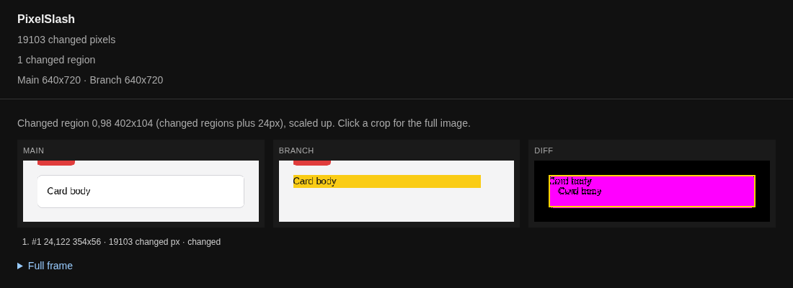

# PixelSlash

PixelSlash is a visual review tool for the web. It takes two versions of a page, Main and Branch
(it shoots them with Playwright, or you hand it PNGs you already have), pixel-diffs them and writes
a `report.html` that shows what changed. The diff is perceptual: anti-aliasing, faint noise and
sub-pixel shifts are told apart from a real change. It is a standalone CLI that needs no Storybook.
Optionally it judges each shot against a design system with a vision model, or uploads the shots
to a review server where a person accepts or rejects them.

## Quickstart

You need [Bun](https://bun.sh) (the CLI runs on it, not on Node; `npx` and `bunx` both start it)
and two screenshots of the same page: Main (the version you ship today) and Branch (your change).
PixelSlash is early (version 0.1.0). It is published as `@hackcove/pixelslash`, but the package is
**not on the npm registry yet**: until it is, build the tarball (`bun install && bun run build:cli`,
then `npm pack` in `packages/cli`) and install the `.tgz` it writes with `npm i -D ./<file>.tgz`.
Once it is published, `npm i -D @hackcove/pixelslash` installs it. The command is `pixelslash`
either way.

```bash
npx @hackcove/pixelslash --live-png a.png --local-png b.png --out out
```

Open `out/report.html`. A run with changes prints how many pixels changed and where the report is:

```
pixelslash: 19103 changed pixels
report: file:///…/out/report.html
```



PNG mode needs no browser.

To shoot two URLs that are already up, install the browser once, then name them. `--live` is Main
(what is live today), `--local` is Branch (your local change); the command does not start a dev
server.

```bash
npx @hackcove/pixelslash install-browser   # once per machine: Playwright's chromium-headless-shell
npx @hackcove/pixelslash --live https://example.com --local http://localhost:3000 --out out
```

Each capture waits for the page to settle (fonts, images, network idle, two animation frames) and
fails after a timeout rather than shooting early or hanging. Exit code 0 means the run finished,
whatever it found in pixels; 1 means a design-system judge found new violations on Branch; 2 is a
usage error. A crash never exits 1; [Exit codes](docs/cli.md#exit-codes-and-the-failed-line) has
the rest.

## What else it does

Everything below is in the [CLI reference](docs/cli.md), which lists every command, flag and exit
code.

- **Many pages:** `--routes FILE` compares a list of paths, and `compare` diffs two snapshot
  directories.
- **A design-system judge:** `--ds DIR` checks each shot against your component rasters with a
  local vision model (mlx on a Mac, or ollama), or a hosted one you name through opencode. With no
  judge installed the run prints `skip: no judge` and invents no violations.
- **Snapshots in CI:** [`pixelslash capture`](docs/cli.md#snapshot-capture-the-pinned-image) shoots
  every route in a config inside a pinned image, so the same commit renders the same pixels on any
  runner. A `v*` tag publishes it to `ghcr.io/madangryscientist/pixelslash-capture`.
- **Your own Playwright tests:** [snapshots from the tests you already
  have](docs/cli.md#snapshots-from-your-own-playwright-tests).
- **A review server:** [`pixelslash upload`](docs/cli.md#uploading-to-a-server) sends shots to a
  PixelSlash server, which diffs them against the default branch, holds the build for review and
  reports a GitHub check. [`pixelslash check`](docs/cli.md#block-ci-on-review) blocks CI until a
  person decides.
- **While you build:** [`pixelslash dev`](docs/cli.md#feature-mode-pixelslash-dev) re-captures a
  page or component on every save and diffs it with the previous iteration, uploading nothing.
- **Your coding agent:** [`pixelslash mcp`](docs/cli.md#your-coding-agent-pixelslash-mcp) is a
  stdio MCP server, so the agent you already run can read builds, changed shots and flakes.
- **Start a repo:** [`pixelslash init`](docs/cli.md#start-a-repo-pixelslash-init) writes a
  `pixelslash.config.ts` from a few questions.

## The review app

The hosted app is at [app.pixelslash.dev](https://app.pixelslash.dev); the project site is
[pixelslash.dev](https://pixelslash.dev).

`apps/web` is the review server: TanStack Start on Cloudflare Workers, D1 for data, R2 for the
shots, GitHub sign-in. CI uploads a build with the CLI, and people review it there. The
[self-host guide](apps/web/SELF-HOST.md) takes you from an empty Cloudflare account (or a box on
your own network) to a first upload. The [API](docs/cli.md#api) under `/api/v1` is a stable
contract: changes are additive only.

Nothing leaves your machine unless you pass `--upload`, and then only to the server you name.
`SECURITY.md` has the rest of the threat model and how to report a vulnerability.

## From source

```bash
bun install
bun run pixelslash -- install-browser   # once, for URL capture
bun run pixelslash -- --live-png main.png --local-png branch.png --out out
```

[`CONTRIBUTING.md`](CONTRIBUTING.md) has the gate (typecheck, lint, format check and tests) and the
rules a change has to keep. The diff engine is checked against a benchmark, and
[`docs/capabilities/matrix.html`](docs/capabilities/matrix.html) (open the file in a browser)
compares what PixelSlash does with other tools, including where it is behind.

## Licence

MIT; see [`LICENSE`](LICENSE) and [`NOTICE`](NOTICE). PixelSlash is a name of Jacobus
Langner; the MIT licence does not grant it.
