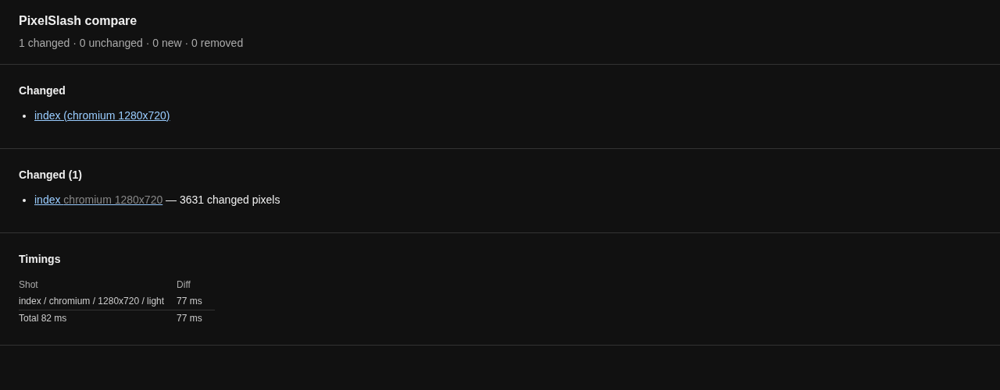
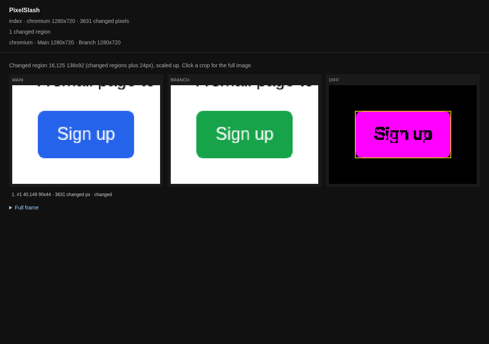

# GitHub Actions

Capture the base branch and the pull request in the pinned image, compare them, keep the report as an artifact, and fail the job when anything differs.

**Tested on** GitHub Actions, on an `ubuntu-24.04` runner, on 2026-11-04, on a private repository. Both the passing run and the failing run are below.

## The gate, first

A pixel-only run exits 0, changed or not. When a run finishes, exit 1 means one thing: new design-system violations on Branch, from a run with `--ds` and a judge. A capture that cannot finish, such as a server that is down, also exits 1, and fails the job too. So `compare` will not fail a job because pixels moved, and there are two ways to make a gate:

- **Without a server: a script over `compare`'s output.** `compare` prints a counts line made for scripts to read, `pixelslash: N changed, N unchanged, N new, N removed`. The script below exits 1 unless changed, new and removed are all 0. Any difference fails the job, wanted or not, and someone reads the report. This page sets up this gate.
- **On review: a server.** On a server you run yourself ([self-hosting](../../apps/web/SELF-HOST.md)), `pixelslash upload --wait`, or `status --wait` on its own, holds the job until a person has decided: exit 0 for accepted or unchanged, 4 for rejected, 5 for still waiting. See [Run a review server](review-server.md).

## The files

The repository has a static page in `site/`. Yours has an app.

`pixelslash.config.ts`. A config has one `baseUrl`, and the job captures two servers, so it comes from the environment:

```ts
export default {
  baseUrl: process.env.BASE_URL ?? "http://localhost:4101",
  routes: ["/"],
  variants: [{ viewport: { width: 1280, height: 720 }, theme: "light" }],
};
```

`ci/visual-gate.sh`, the gate. It takes the compare command as its arguments:

```sh
#!/bin/sh
# Usage: visual-gate.sh COMPARE_COMMAND...   (the command, ending at its --out DIR)
# Exit 0 only when compare says nothing differs. compare's own code passes through.
out=$("$@")
code=$?
printf '%s\n' "$out"
[ "$code" -eq 0 ] || exit "$code"
case "$out" in
  *"pixelslash: 0 changed, "*" unchanged, 0 new, 0 removed"*) exit 0 ;;
esac
echo "visual gate: differences found, read the report" >&2
exit 1
```

`.github/workflows/visual.yml`:

```yaml
name: Visual check

on:
  pull_request:
  workflow_dispatch:

env:
  IMAGE: ghcr.io/madangryscientist/pixelslash-capture@sha256:d8b33a8e9fac68f41d04e5295cdf7b57ab22affca73f081f2b18241d2e633fff

jobs:
  visual:
    runs-on: ubuntu-24.04
    steps:
      - uses: actions/checkout@v4
        with:
          fetch-depth: 0 # the base branch has to be there to capture it

      - name: Pull the pinned capture image
        run: |
          docker pull "$IMAGE"
          echo "DIGEST=$(docker inspect --format '{{index .RepoDigests 0}}' "$IMAGE")" >> "$GITHUB_ENV"

      - name: Serve the base branch and this branch
        run: |
          git worktree add --detach .base "origin/${GITHUB_BASE_REF:-main}"
          python3 -m http.server 4101 --directory .base/site >/dev/null 2>&1 &
          python3 -m http.server 4102 --directory site >/dev/null 2>&1 &
          sleep 1

      - name: Capture the base branch
        run: |
          docker run --rm --network host -v "$PWD:/work" \
            -e BASE_URL=http://localhost:4101 -e PIXELSLASH_IMAGE_DIGEST="$DIGEST" \
            "$IMAGE" capture --out snapshots/main

      - name: Capture this branch
        run: |
          docker run --rm --network host -v "$PWD:/work" \
            -e BASE_URL=http://localhost:4102 -e PIXELSLASH_IMAGE_DIGEST="$DIGEST" \
            "$IMAGE" capture --out snapshots/branch

      - name: Compare, and fail on a difference
        run: |
          sh ci/visual-gate.sh docker run --rm -v "$PWD:/work" "$IMAGE" \
            compare snapshots/main snapshots/branch --out pixelslash-report

      - name: Keep the report
        if: always()
        uses: actions/upload-artifact@v4
        with:
          name: pixelslash-report
          path: pixelslash-report
```

Four things in it matter:

- `fetch-depth: 0`: the default checkout has one commit, and the job needs the base branch.
- The image is named by digest, not by tag, so a job cannot change what renders it without a commit. See [Pin versions in CI](pin-versions.md).
- `--network host` lets the container reach the servers on the runner's `localhost`.
- `if: always()` keeps the report when the gate fails, which is when you want it.

The two `python3` lines stand for "start your app": put your own start command in their place, one server per version. The image is the whole CLI, so the runner installs nothing else.

## What it prints

Each capture step:

```
pixelslash: 1 snapshots
timing: 1 shot, capture 0.8s, total 1.2s
fingerprint: {"image":"ghcr.io/madangryscientist/pixelslash-capture@sha256:d8b33a8e9fac68f41d04e5295cdf7b57ab22affca73f081f2b18241d2e633fff","browser":"chromium 156.0.8078.4","fonts":"sha256:b94a854b9906469b346d4f39cae49b20342e1abc9501e597fed6b1c44d5a0bbb"}
manifest: /work/snapshots/main/manifest.json
```

With nothing different, the compare step passes on `pixelslash: 0 changed, 1 unchanged, 0 new, 0 removed`. On a pull request that turned a button green, it fails:

```
timing: 1 shot, diff 0.1s, total 0.1s
visual gate: differences found, read the report
pixelslash: 1 changed, 0 unchanged, 0 new, 0 removed
changed:
  index (chromium 1280x720)
report: file:///work/pixelslash-report/index.html
##[error]Process completed with exit code 1.
```

The `file:///work` path is inside the container. The report is in the artifact.

## Read the report

Open the run's page, download `pixelslash-report` from its artifacts, unzip it, and open `index.html`:





The count differs from the same change on another machine, because this image's fonts are not that machine's fonts. That is what the image is for: the same count on every run.

## Next

- The same run as a plain script: [Any other CI](any-ci.md).
- Make the job wait for a person's yes: [Run a review server](review-server.md).
