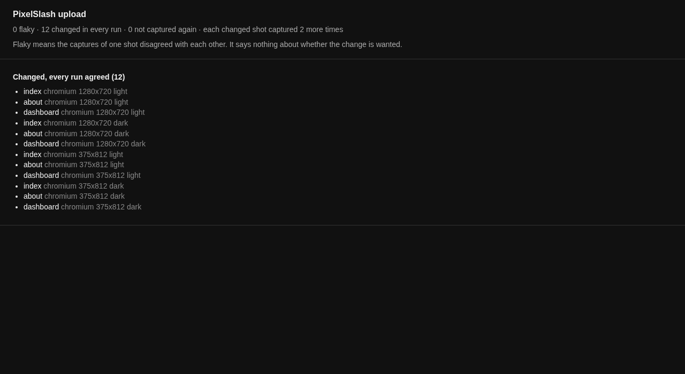

# Run a review server

The CLI and `compare` work with no server. A team needs one when a person's yes or no has to be recorded and a CI job has to wait for it.

Everything on this page runs on a server you run yourself. [Self-hosting](../../apps/web/SELF-HOST.md) has how to set one up.

## What it adds

- **Builds in one place**, each measured against a baseline the server picks, so nobody has to pass reports around.
- **A recorded decision** per change: accepted or rejected, by someone in your organisation.
- **A gate on that decision**: `upload --wait` and `status --wait` hold the job, then exit with what was decided.
- **Flake retries**: a changed shot is captured again, so a shot that differs from itself is told apart from a real change, and its policy (review or skip) takes effect.

## Upload and wait

Point the CLI at your server, with a token from your CI's secret store:

```
export PIXELSLASH_SERVER=https://<your server>
export PIXELSLASH_TOKEN="$PIXELSLASH_CI_TOKEN"
```

Upload Main's snapshots first, as the baseline. The default branch's new shots are accepted automatically:

```
npx pixelslash upload snapshots/main --branch main --wait --timeout 2m
```

```
pixelslash: uploaded 12 snapshots
build: a606f702-… (5f2ce7e on main)
report: file:///…/my-site/snapshots/main/report.html
timing: 12 shots, diff 0.0s, upload 1.2s, total 1.3s
build a606f702-…  http://localhost:8787/projects/p/builds/a606f702-…
passed: 0 waiting · 12 accepted · 0 rejected
```

Then the branch. This one had changes nobody had looked at yet, so the wait ran out. Two lines are left out of this output, a warning and the report's path:

```
BASE_URL=http://localhost:4102 npx pixelslash upload snapshots/branch --branch my-change --base main --wait --timeout 20s
```

```
pixelslash: uploaded 12 snapshots
build: 5845a320-… (07412f9 on my-change)
timing: 12 shots, diff 0.3s, upload 16.5s, total 16.5s
waiting on build 5845a320-…: changes: 12 waiting · 0 accepted · 0 rejected
build 5845a320-…  http://localhost:8787/projects/p/builds/5845a320-…
changes: 12 waiting · 0 accepted · 0 rejected
still waiting after 20s
```

Exit 5. Keep `BASE_URL` set on this command: a retry shoots the changed shot again, from the server your config points at. The local `report.html` shows what the retries found:



## Read the decision

`status --wait` picks up the same build, from the `build.json` that `upload` left in the directory:

```
npx pixelslash status --dir snapshots/branch --wait --timeout 1m
```

If they were rejected, it exits 4:

```
failed: 0 waiting · 0 accepted · 12 rejected
```

If they were accepted, it exits 0:

```
passed: 0 waiting · 12 accepted · 0 rejected
```

| Exit | Meaning |
| --- | --- |
| 0 | accepted or unchanged |
| 4 | rejected |
| 5 | still waiting when the timeout ran out |
| 3 | a server or build error |
| 2 | usage |

These ran against a throwaway server on one machine, so the links are `localhost`. [Block CI on review](../cli.md#block-ci-on-review) has the same steps for a CI job.

## Next

- Set up the server: [self-hosting](../../apps/web/SELF-HOST.md).
- The upload flags: [Uploading to a server](../cli.md#uploading-to-a-server).
