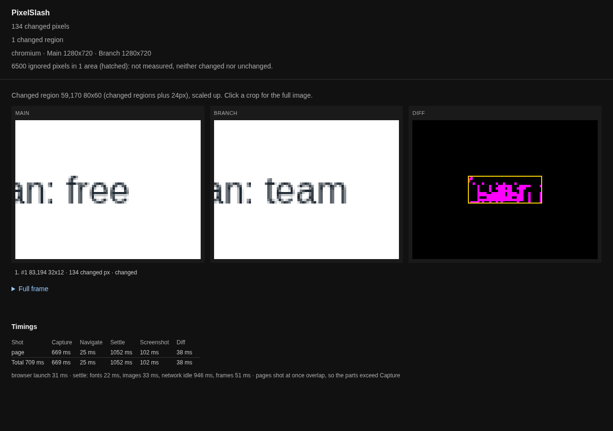

# Ignore or redact

Both leave part of a page out of the comparison. The difference is what they do to the stored image.

- **Ignore** keeps the pixels in the image and doesn't measure them. Use it for things that change by themselves: videos, ads, maps and live data.
- **Redact** paints over the pixels before the PNG is written, so the content is gone. Use it for secrets and personal data.

| Setting | Pixels in the stored shot | Measured | How you set it |
| --- | --- | --- | --- |
| `--ignore x,y,w,h` | kept | no | a flag on a pair run |
| config `ignore` | kept | no | selectors or rectangles in the config |
| `data-pixelslash-ignore` | kept | no | an attribute in your own HTML |
| config `masks` | painted `#FF00FF` | yes, as flat colour | selectors or rectangles in the config |

An ignored area still gets uploaded when you upload. **If it must not leave your machine, redact it.**

## `--ignore`: one area on a pair

On a pair run, give the area in image pixels. Repeat the flag for more areas:

```
npx pixelslash --live-png main.png --local-png branch.png --ignore 10,10,140,60
```

The pair from [Thresholds](thresholds.md) has 4,836 changed pixels. With that box over the larger change, it has 36:

```
pixelslash: 36 changed pixels
```

The manifest records the area as `ignored` and counts what it covered as `ignoredPixels`, 8,400 here. Nothing inside it is counted, grouped into a region or reported.

The report hatches the area and says plainly what happened:

```
6500 ignored pixels in 1 area (hatched): not measured, neither changed nor unchanged.
```



`--ignore` is for one pair, and it stops the run if you add `--routes`.

## Config `ignore`: selectors that follow the element

A selector works wherever the element ends up on the page. The value can sit at project, route or variant level, and the levels add up. A variant doesn't replace its route's list.

```json
{
  "baseUrl": "http://localhost:4000",
  "routes": [{ "name": "dash", "path": "/", "ignore": [".live"] }]
}
```

When the shot is taken, each selector becomes a box in the manifest:

```json
"ignore": [{ "x": 0, "y": 60, "width": 1280, "height": 100 }]
```

Capture only records the box. `compare`, or a server after an upload, skips it. A `.live` panel whose text went from 12 to 57 users online:

```
npx pixelslash capture --out s-a
npx pixelslash capture --out s-b
npx pixelslash compare s-a s-b --out o-ab
```

```
pixelslash: 0 changed, 1 unchanged, 0 new, 0 removed
```

A selector that matches nothing prints a warning, so a renamed class doesn't quietly stop protecting the shot.

## `data-pixelslash-ignore`: in your own markup

If you own the element, mark it. No config entry is needed:

```html
<div class="live" data-pixelslash-ignore>12 users online</div>
```

It gives the same box and the same result as the config entry.

## An ignored element that changes size

An ignored element can still move what is around it. PixelSlash ignores the element, not its effect on the rest of the page.

To compare, it uses both shots' boxes together, so an element that moved is covered at its old place and its new one. Everything outside those boxes is measured normally. Here the `.live` panel grew from 100 to 200 pixels tall and pushed two rows down:

```
pixelslash: 1 changed, 0 unchanged, 0 new, 0 removed
changed:
  dash (chromium 1280x720)
```

The shot's report says:

```
51229 changed pixels
1 changed region
256000 ignored pixels in 2 areas (hatched): not measured, neither changed nor unchanged.
#1 0,260 1280x57 · 51229 changed px · changed
```

Nothing inside the panel counts. The rows that moved below it do, and that's correct: the page did change. If you don't want that reported, give the panel a fixed height.

On a server, a changed region that touches the edge of an ignored area also carries a warning: `content may have moved out of the ignored area`.

## Masks: redact

`masks` take the same selectors and rectangles, and paint them `#FF00FF` before the PNG is written:

```json
{
  "baseUrl": "http://localhost:4000",
  "masks": [".email", ".nothing-here"],
  "routes": [{ "name": "dash", "path": "/" }]
}
```

```
warning: mask ".nothing-here" matched no shot in this run
pixelslash: 1 snapshots
```

In the stored shot `.email` is a solid magenta strip with no text. No other copy of it exists, in the manifest or anywhere else.

A mask paints the area on both sides, so a mask of the same size in the same place compares as unchanged. If the masked element moves or changes size, the magenta moves too, and that shows as a change. To cover an element whose size varies, combine a mask with `ignore`.

## Videos and other media

A `<video>` or similar element renders unreliably, so PixelSlash warns about it:

```
warning: <video> at 580,36 112x118 on overview (desktop) — media renders unreliably; add an exclusion zone (route.ignore) for this shot
```

Nothing is paused for you. A medium that sits wholly inside an ignored area does not warn.

## Next

- [Thresholds](thresholds.md): tolerance for the whole shot.
- [Flaky shots and stabilisation](flaky-shots.md): find what keeps moving.
- [Snapshot capture](../cli.md#snapshot-capture-the-pinned-image): the full config.
