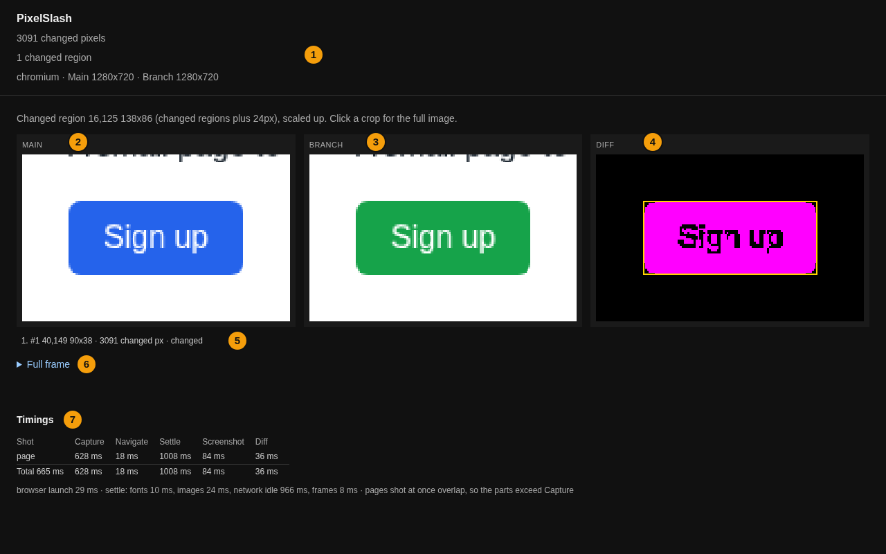
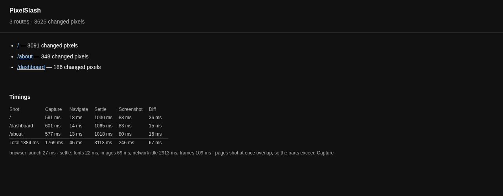

# Reading a report

A run writes `report.html` and prints its address. It opens as a plain file, with no server. The numbers below match the numbered marks in the picture.



## 1. The header

The header holds the verdict and what it rests on:

```
3091 changed pixels
1 changed region
chromium · Main 1280x720 · Branch 1280x720
```

A few more lines appear only when they apply:

| Line | What it tells you |
| --- | --- |
| `Diff options: threshold 0.2` | You changed a setting from its default |
| `Not changed: 36 changed pixels are under the floors above.` | Pixels differ, but your [floors](thresholds.md) make this not a change |
| `6500 ignored pixels in 1 area (hatched): not measured, neither changed nor unchanged.` | Part of the page was [left out](ignore-or-redact.md) |
| `Main 1280x720 · Branch 1280x760` | The sizes differ, so only the overlap was compared |
| `identical to baseline: same bytes, not diffed` | The two PNGs are the same file contents. Nothing was decoded |

## 2, 3 and 4. Main, Branch and Diff

The three crops show the same part of the page, cut around the changed regions plus 24 pixels and scaled up. A note above them gives the area:

```
Changed region 16,125 138x86 (changed regions plus 24px), scaled up. Click a crop for the full image.
```

**Main** is what you compared against, and **Branch** is your change. **Diff** shows the changed pixels in magenta on black. A yellow box marks a `change` region, and a dashed grey box marks noise.

## 5. The region list

Each region gets a line with its place, size and pixel count:

```
#1 40,149 90x38 · 3091 changed px · changed
```

The word at the end is the [kind](how-a-comparison-works.md#regions): `changed`, `noise` or `shifted`, with the reason for the last two. Only `changed` makes a run `changed`.

## 6. Full frame

**Full frame** opens Main, Branch and Diff at full size, for when the change is not where you were looking.

## 7. Timings

The table says where the time went: capture, navigation, settling, the screenshot and the diff. Its footer breaks the settle into fonts, images, network idle and frames. A slow settle usually has a slow network request behind it.

## Many pages: the index

With `--routes`, or with `compare` on two snapshot directories, the run also writes `index.html`, with one line per page, each linking to that page's report.



`compare`'s index groups shots as **Changed**, **New on Branch**, **Removed from Branch**, **Not compared** and **Unchanged**, with a count at the top:

```
1 changed · 1 unchanged · 0 new · 0 removed
```

If the two sides were rendered by different environments, a warning at the top lists which, because [a font change would show up as a change](fingerprints.md) there.

## The flaky view

An upload that captured its changed shots again writes `report.html` in the snapshot directory, titled **PixelSlash upload**:

```
1 flaky · 0 changed in every run · 0 not captured again · each changed shot captured 2 more times
Flaky means the captures of one shot disagreed with each other. It says nothing about whether the change is wanted.
```

Each flaky shot then shows `flaky: 1 of 3 runs differed`, its policy, every run side by side, and where the runs differed. Shots below that are listed under **Changed, every run agreed**: those are the changes to take seriously. [Flaky shots and stabilisation](flaky-shots.md) has what to do with them.

## The parity view

A project with web and native shots of the same screen has a parity view on the server, which shows the platforms side by side. It's a read-only view: no status, exit code or count depends on it. [Parity view](../cli.md#parity-view) has the details.

## Next

- [How a comparison works](how-a-comparison-works.md): what the numbers mean.
- [The report](../cli.md#the-report): every section, including the design-system judge's.
- [Thresholds](thresholds.md): when a report is too sensitive.
