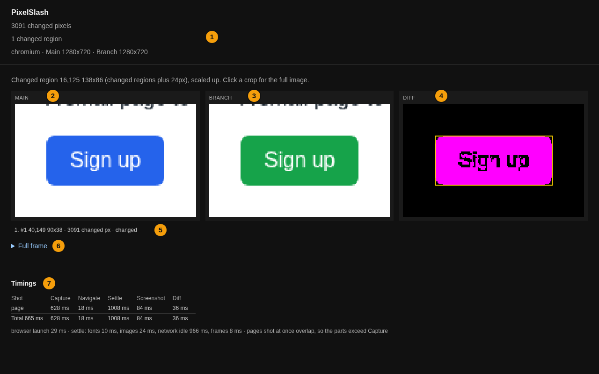

# Getting started

Install PixelSlash, compare two versions of a page, and read the report it writes. It takes about fifteen minutes, and everything here runs on your machine: nothing is uploaded unless you ask for it.

## Install

PixelSlash is a Bun CLI that ships on npm. It needs [Bun](https://bun.sh) on your `PATH`, and this page uses npm and `npx` to run it. Start in an empty directory:

```
mkdir my-site && cd my-site
npm init -y
npm i -D @hackcove/pixelslash
npx pixelslash install-browser
```

`install-browser` fetches Playwright's `chromium-headless-shell` once. It is for comparing URLs; comparing PNGs needs no browser. The full install notes, including a checkout and the other browsers, are in [Install](cli.md#install).

Check that it runs:

```
$ npx pixelslash --version
pixelslash 0.1.0
```

That number is the engine inside the package, not the package itself. `npm ls @hackcove/pixelslash` prints the version you installed.

## Serve two versions of a page

`--live` is Main, the version you trust. `--local` is Branch, the version you are checking. Both must already be up: PixelSlash does not start a dev server.

If you have an app, run it twice, on main and on your branch, and skip to the next section. Otherwise, make a small page:

```
mkdir main
cat > main/index.html <<'HTML'
<!doctype html>
<html lang="en">
  <head>
    <meta charset="utf-8" />
    <title>My site</title>
    <style>
      body { font: 16px/1.5 sans-serif; margin: 40px; color: #1f2933; }
      button { background: #2563eb; color: #fff; border: 0; border-radius: 6px; padding: 10px 18px; font-size: 16px; }
    </style>
  </head>
  <body>
    <h1>My site</h1>
    <p>A small page to try PixelSlash on.</p>
    <button>Sign up</button>
  </body>
</html>
HTML
```

Copy it to Branch and turn the button green there. This is GNU `sed`; on a Mac, use `sed -i ''`, or edit the file by hand:

```
cp -r main branch
sed -i 's/#2563eb/#16a34a/' branch/index.html
```

Serve each copy on its own port, and leave them running:

```
npx --yes serve -l 4101 main &
npx --yes serve -l 4102 branch &
```

## Compare two URLs

```
npx pixelslash --live http://localhost:4101 --local http://localhost:4102 --out .pixelslash
```

It captures both pages once each has settled, diffs them, and prints where the report is:

```
pixelslash: 3091 changed pixels
report: file:///…/my-site/.pixelslash/report.html
timing: 1 shot, capture 0.7s, diff 0.0s, total 0.7s
```

Your count can differ from this one, because your machine has different fonts.

`--out` (default `.pixelslash`) now holds the whole run:

```
$ ls .pixelslash
branch.png  diff.png  live.png  local.png  main.png  manifest.json  report.html
```

`live.png` and `local.png` are the two captures, named after the flags. `main.png` and `branch.png` are what the report shows, `diff.png` marks the changed pixels, and `manifest.json` holds the numbers. `report.html` opens as a plain file in any browser.

## Open the report

Open `.pixelslash/report.html`:



1. The changed-pixel count, the number of changed regions, and both shot sizes.
2. **Main**, cropped to the changed region and scaled up. Click a crop for the full image.
3. **Branch**, the same crop.
4. **Diff**, the same crop, with the changed pixels marked.
5. The list of regions: where each one is, how big, and how many pixels changed in it.
6. `Full frame`, a fold with the whole shot, where the Diff has the region boxes drawn on it.
7. `Timings`, the time each stage of the run took.

A shot with nothing changed shows the full frame as it is, and the next run below leaves no `diff.png`. [The report](cli.md#the-report) lists everything on it.

The report tells you what changed. Whether the change is right is for you to decide.

## Change one thing and run again

Say you did not mean it. Put the button back on Branch, and run again:

```
cp main/index.html branch/index.html
npx pixelslash --live http://localhost:4101 --local http://localhost:4102 --out .pixelslash
```

```
pixelslash: 0 changed pixels
report: file:///…/my-site/.pixelslash/report.html
timing: 1 shot, capture 0.7s, diff 0.0s, total 0.7s
```

## The exit code

Right after that run:

```
$ echo $?
0
```

The exit code is 0 for a pixel-only run, changed or not: the first run, with its green button, exited 0 too. When a run finishes, exit 1 means one thing only: new design-system violations on Branch, and you only get those when you ask for a judge with `--ds`, as [Your first review](tutorials/first-review.md) shows. A capture that cannot finish, such as a server that is down, also exits 1. To fail a CI job on a pixel difference, see [Run it in CI](ci/github-actions.md).

## Compare two PNGs

Already have screenshots? Hand them over and skip the browser. These two came from the run above:

```
cp .pixelslash/main.png .pixelslash/branch.png .
npx pixelslash --live-png main.png --local-png branch.png --out .pixelslash --label "button colour"
```

```
pixelslash: 0 changed pixels
report: file:///…/my-site/.pixelslash/report.html
timing: 1 shot, diff 0.0s, total 0.0s
```

`--label` is optional text that is kept in the run's manifest. These two are the same picture, because the button went back, so nothing was diffed: the report says `identical to baseline: same bytes, not diffed`.

Leave the servers up if you are going on to [your first review](tutorials/first-review.md). Otherwise, stop them with `kill %1 %2`.

## Next

- Your own project: [choose how to capture](tutorials/choose-capture.md), and follow the tutorial for that route.
- A change, found, read and judged: [your first review](tutorials/first-review.md).
- Fail a CI job on a difference: [GitHub Actions](ci/github-actions.md), and the other providers beside it.
- Too noisy, or too strict? [Tune the diff](cli.md#tuning-the-diff) with a threshold, floors or an ignored area.
- Capture every page of your app the same way every time: [snapshot capture](cli.md#snapshot-capture-the-pinned-image), or [your own Playwright tests](cli.md#snapshots-from-your-own-playwright-tests).
- Keep the builds in one place, on a server you run yourself: [run a review server](ci/review-server.md), [upload to it](cli.md#uploading-to-a-server), and [sign in and read builds](cli.md#signing-in-and-reading-builds).
- Make CI wait for a human's yes, also on your own server: [block CI on review](cli.md#block-ci-on-review).
- Set up a repo in one command: [`pixelslash init`](cli.md#start-a-repo-pixelslash-init).
