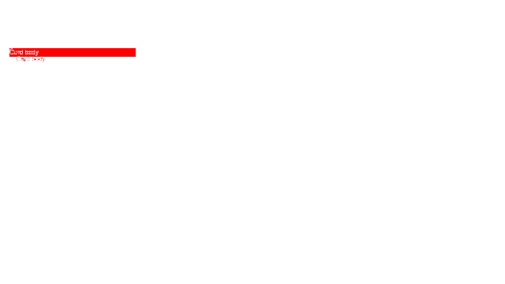
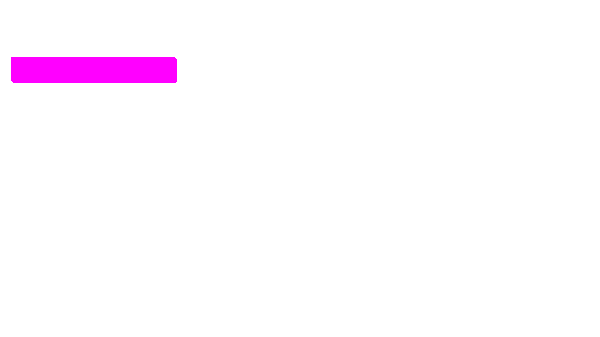

# Argos, run locally as a benchmark rival (ob 1476)

Argos (MIT, `github.com/argos-ci/argos`) is the closest rival in
the maintainer's competitor research. This spike got its screenshot comparison running on our own
hardware, so the benchmark ticket can feed the same pairs to Argos and to PixelSlash and compare
verdicts. **No Argos code is in this repo.** Argos runs from its own checkout inside a VM, and the
only Argos-facing code we wrote is the wrapper in `ops/argos-bench/argos-diff.ts`, which imports
their function.

How to rebuild it, start it, stop it and destroy it: `ops/argos-bench/runbook.md`.

## What was run, and why only that

**Only Argos's image-comparison step, not the full app.** The maintainer decided this on 2026-10-19,
after the host check found the Proxmox host at 15.5 GiB RAM with about 6.6 GiB free, 4 cores and swap already in
use. The full app needs Postgres, Redis, RabbitMQ, S3 and a GitHub App to accept a build. None of
that changes the per-screenshot verdict, which is what the benchmark compares, and none of it was
started.

The comparison step does not need those services. Our wrapper runs it with `--network none`.
Their own unit tests for this path (27 of them) pass in the same container with no network, no
database and no queue.

| | |
| --- | --- |
| Argos commit | `21e8520c28129d501b22028a5499546b03336e38` (2026-10-16, "feat(build): point an outdated build to the latest build of its suite (#2668)") |
| runtime | `node:26-bookworm-slim` (Node v26.12.0), pnpm 11.28.2 (their `packageManager` pin), tsx 4.23.15 to run the wrapper |
| diff engine | `odiff-bin` 4.5.0 (a native binary). `sharp` 0.35.5 for dimensions and padding. `tmp` 0.2.7 for temp paths |
| installed | the repo root (for vitest) and `@argos/backend` with its workspace deps (`pnpm install --filter . --filter "@argos/backend..."`), then their `tsdown` build of `@argos/util`, `@argos/schemas` and `@argos/knex-scripts`. The frontend is not installed |
| where | VM `argos-bench` on a Proxmox host, address by DHCP, 2 vCPU / 2048 MB / 20 GB, Debian 13, Docker 26.1.5 |
| cost | image 1.6 GB. Peak VM memory 1.2 GB during the build, about 0.4 GB idle. One pair takes about 1 s, and a 3-pair run from the maintainer's machine took 5 s including ssh |

## The code path

The upload, queue and S3 parts of Argos only decide *which* pairs get compared. The verdict comes
from one function:

| file (at the pinned commit) | role |
| --- | --- |
| `apps/backend/src/screenshot-diff/diff/image/index.ts` | **`diffImages(base, head, { threshold })`**: the whole comparison. Returns `{ score, file? }` |
| `apps/backend/src/screenshot-diff/diff/types.ts` | `DiffResult`, `DiffOptions` (`threshold` 0–1, default 0.5) |
| `apps/backend/src/storage/ImageHandle.ts`, `FileHandle.ts`, `sharp.ts` | image dimensions and the `enlarge` padding. `LocalFileHandle` reads a local path, `S3FileHandle` downloads one |
| `apps/backend/src/screenshot-diff/computeScreenshotDiff.ts` | the job: loads the pair from S3/DB, calls `diffFiles` → `diffImages`, then applies "ignored change" fingerprints from the DB |
| `apps/backend/src/build/createBuildDiffs.ts` | pairs base and head screenshots in a build. Byte-identical files (same S3 id) are scored 0 without running a diff |
| `apps/backend/src/screenshot-diff/diff/image/index.test.ts` + `__fixtures__/` | their calibration table: 20 named cases (fontAliasing, imageCompression1–7, boxShadow, minorChange1–3, …) with the expected changed/unchanged verdict |
| `apps/backend/src/screenshot-diff/diff/image/test/diff.test.ts` | their snapshot scores for simple synthetic pairs, run through `LocalFileHandle`. Our wrapper calls `diffImages` the same way |

Two things in the full app sit outside `diffImages`, so the wrapper does not reproduce them:

- **The byte-identical shortcut.** It gives the same verdict, because odiff also scores identical
  files 0.
- **"Ignored changes".** These are per-project fingerprints of diffs that a human dismissed before
  (`@argos-ci/mask-fingerprint`). They are memory of earlier reviews, not comparison, so a fresh
  benchmark has none.

## How their comparison works

This is what the code does at the pinned commit. Their in-code comments are the only
documentation of it, and they say they benchmarked pixelmatch and looks-same and found both too
slow.

1. **Sizes.** Take the larger width and the larger height of the two images, capped at 80 Mpx.
   Pad the smaller image to that size with **transparent** pixels, anchored top-left (`sharp`
   `fit: contain`, `position: left top`). So unlike PixelSlash, **the non-overlapping area counts as
   changed**.
2. **Two odiff passes** over the same pair, both with `antialiasing: true` (odiff skips pixels it
   detects as anti-aliasing) and `outputDiffMask: true` (the diff PNG is only the changed pixels,
   in red, on transparency):
   - a **base** pass with colour threshold `0.15 × 2t`
   - a **colour-sensitive** pass with threshold `0.0225 × 2t`

   Here `t` is the screenshot's threshold, 0.5 by default, so the multiplier is 1. A pass's score is
   odiff's `diffPercentage / 100`, and is 1 on a layout mismatch.
3. **Noise floors.**
   - The base score is zeroed if it is below `min(0.0002 × 2t, 20 × 2t / pixels)`. That ignores
     about 20 pixels on a large shot.
   - The colour-sensitive score is zeroed if it is **below 3% of the image** (`0.03 × 2t`).
4. **The verdict** is the larger of the two surviving scores, with the diff image from that pass.
   **A score of 0 means unchanged, with no diff image. A score above 0 means changed.** There is no
   region list, bounding box or per-component reason: just one float and one mask PNG.

The `threshold` comes from the SDK per screenshot (`headScreenshot.threshold`), so a project can
loosen or tighten single shots. The wrapper takes `--threshold`.

**What this means for the benchmark.** A subtle colour shift is only reported if it covers at
least 3% of the shot. A strong change is reported from about 20 pixels up. Anti-aliased edges
are ignored. A size change makes the padding count as changed.

## Fixture run (2026-10-19)

The fixture pair `fixtures/pages/live.html` → `fixtures/pages/local.html` was captured by PixelSlash
at 1280×720 on the desktop. In the head version the card loses its white background, border and
padding and turns yellow. The base and head are `argos-local/pages.base.png` and
`argos-local/pages.head.png`. Two `fixtures/ds` pairs were added to cover the "same" and
"different size" edges. All three went through `run-pairs.sh` in one call:

```
{"name":"ds-button-same","changed":false,"score":0,"threshold":0.5,"width":null,"height":null,"diff":null}
{"name":"ds-button-vs-card","changed":true,"score":0.6459,"threshold":0.5,"width":160,"height":80,"diff":"…/ds-button-vs-card.diff.png"}
{"name":"pages","changed":true,"score":0.0074,"threshold":0.5,"width":1280,"height":720,"diff":"…/pages.diff.png"}
```

| pair | Argos | PixelSlash |
| --- | --- | --- |
| `pages` (live → local) | **changed**, score 0.0074 (about 6,800 px of 921,600) | changed, 19,794 px |
| `ds-button-same` (button.png against itself) | unchanged, score 0 | (identical, 0) |
| `ds-button-vs-card` (120×40 against 160×80) | changed, 0.6459 over the padded 160×80 | diffs only the 120×40 overlap and states both sizes (invariant 1) |

Argos diff for `pages`:



PixelSlash diff for the same pair:



**Observed difference.**
- **Argos** marks the new yellow strip and the text that moved. It does **not** mark the rest of
  the old white card turning into the `#f3f3f3` page background. That change is below the base
  pass's 0.15 threshold. The colour-sensitive pass sees it, but at about 2% of the shot it falls
  under the 3% floor and is zeroed.
- **PixelSlash** paints the whole old card.

Both call the pair changed. They disagree on *where*, and that is the kind of finding the
benchmark is for.

The `ds-button-vs-card` diff is `argos-local/ds-button-vs-card.argos-diff.png`.

## Feeding it N pairs from a script

The benchmark ticket needs exactly this interface:

```
ops/argos-bench/run-pairs.sh <pairs-dir> <out-dir> [--threshold n]
```

- **Input:** `<pairs-dir>/<name>/base.png` and `head.png`, one directory per pair. The names
  become the result keys.
- **Transport:** `tar` over ssh to `$VM` (your key), then
  `docker run --network none --user debian` with the pair directory mounted. No port is open,
  because the VM serves nothing.
- **Output:**
  - `<out-dir>/verdicts.jsonl`: one object per pair, `{name, changed, score, threshold, width,
    height, diff}`. `diff` is a local path, or `null` when unchanged.
  - `<out-dir>/<name>.diff.png`: the red-on-transparent mask.
- **Exit codes:** non-zero if ssh or the container fails. Bad input, such as a missing `head.png`,
  fails the whole run, and the container's error goes to stderr.
- **Preconditions:** the VM must be running (`qm start $VMID`). The address is not reserved, so use
  `ARGOS_BENCH_HOST=<user>@<ip>` if it changed. `provision-vm.sh` re-finds it.
- **Calibration set:** Argos's own `__fixtures__` cases, with their expected verdicts in
  `index.test.ts`, are inside the image at
  `/argos/apps/backend/src/screenshot-diff/diff/image/__fixtures__/<case>/{base,compare}.png`. The benchmark can run
  PixelSlash on those too, without copying them into this repo.
