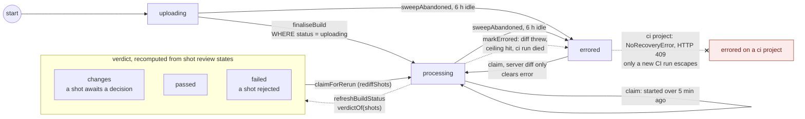
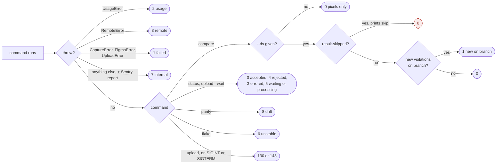
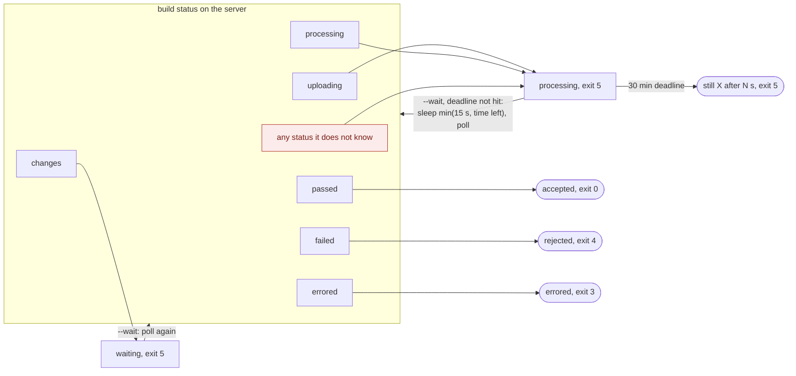
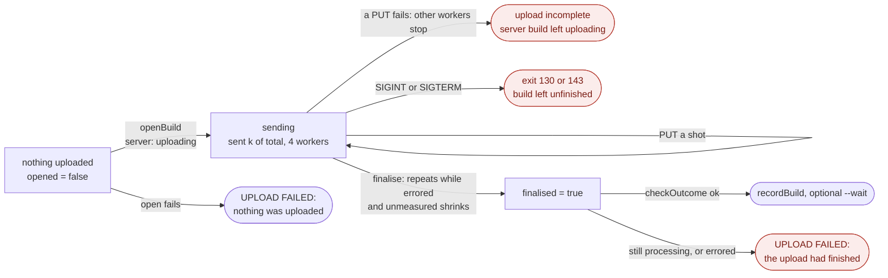
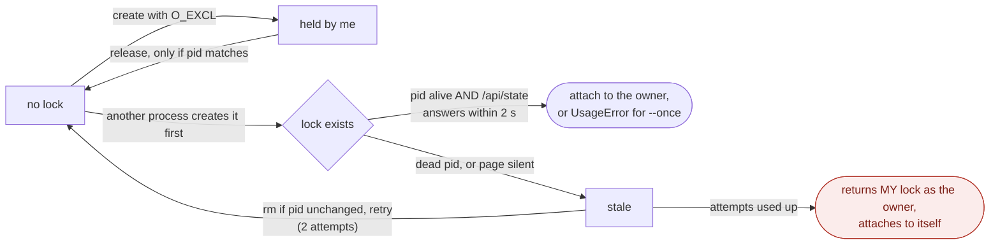
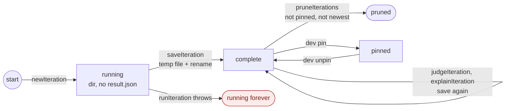
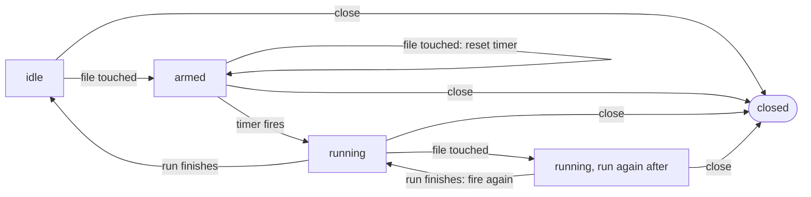
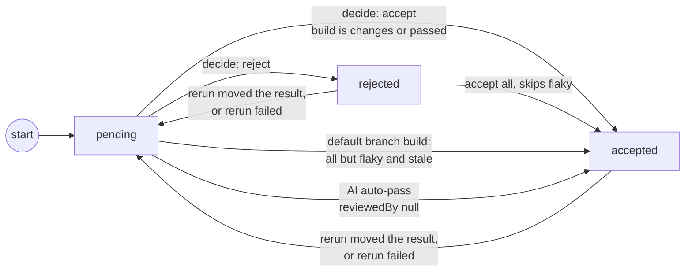
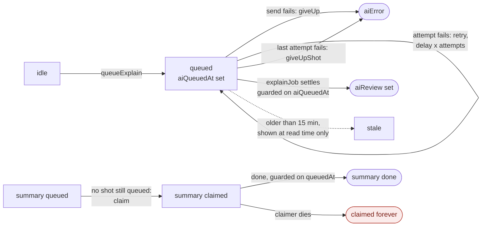
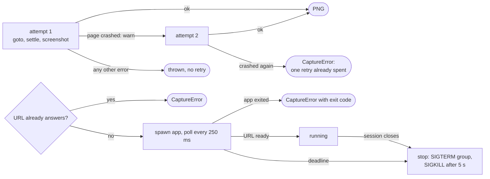

# Implicit state machines

Every place where something in PixelSlash moves through named states without an explicit state machine, read from `main` at 009c833 (2026-11-11). CLI first, then the engine, then the web app. `apps/site` has none: it is content only.

No status column has a CHECK constraint or a transition table. The only rules are in TypeScript.

**How to read the diagrams**

- Solid arrow: a guarded write (it checks the current state, or it is the only writer).
- Dashed arrow: an unguarded write that updates by id whatever the state is.
- Red box (`gap`): a state that can get stuck, or a wrong outcome.

## The gaps that matter most

1. **`--routes` can hide new violations and exit 0.** `compareRoutes` keeps only the last route's `skipped` (`packages/engine/src/compare.ts:97`). If an earlier route finds a new violation and the last route has no judge, the run prints `skip:` and exits 0. That breaks repo invariant 3.
2. **Build status writes have no guard.** `markErrored` (`apps/web/src/diff/build-writes.ts:87`) and `refreshBuildStatus` (`apps/web/src/db/review.ts:55`) update by id. A run that outlived its 5 minute claim can overwrite the verdict a re-claimer wrote, and a late AI explain can turn an `errored` or re-running build into a verdict.
3. **The dev lock can name the caller as its own owner** after two failed attempts (`packages/engine/src/dev-lock.ts:110`), so `dev` attaches to itself.
4. **A failed upload says "the upload had finished".** `finalised` is set before `checkOutcome` (`packages/engine/src/upload.ts:249`).

## Build status (the central machine)

`apps/web/src/db/schema.ts:191` `BUILD_STATUSES`, default `uploading`. Writers: `diff/claim.ts`, `diff/process.ts`, `diff/rerun.ts`, `db/review.ts`, `db/abandoned.ts`.

Inside the verdict, every review decision, flake label, AI auto-pass and moved build re-runs `refreshBuildStatus`, which can move between `changes`, `passed` and `failed`. No status is terminal: a verdict can be re-run, and `errored` can be re-claimed on a server project. The schema comment at `schema.ts:203` says nothing moves a build back, which the rerun and re-claim paths contradict.

Gaps:

- `markErrored` and `refreshBuildStatus` are unconditional updates. The 5 minute claim has no fence (admitted at `diff/claim.ts:16`), so the original run and the re-claimer can both write the final state.
- The explain consumer (`ai/explain-queue.ts:253`) calls `refreshBuildStatus` without checking the build is in a verdict state, so it can turn `processing` or `errored` into a verdict.
- The snapshot PUT guard (`db/builds.ts:160`) reads then inserts, so a PUT racing finalise can land after the count check.
- An abandoned build that was never processed can only be escaped by uploading again (`diff/rerun.ts:146`).

## CLI exit codes (the run's terminal states)

`packages/cli/src/run.ts:93` to `109` (summary) and `251` to `283` (errors); `status.ts`, `parity-pairs.ts:18`, `flake.ts:35`, `upload.ts:200`.

Gaps:

- With `--routes`, `result.skipped` is the last route's value (`engine/src/compare.ts:97`). Earlier violations are masked as `skip:` and exit 0; an earlier skip is hidden when the last route was judged.
- The Sentry upload report is chosen by matching the text `UPLOAD FAILED:` in the message (`run.ts:236`), not by error type.
- The CI template comment (`init.ts:264`) lists 0, 4, 5, 3 and 2 and leaves out 1 and 7, which the same commands can return.

## `status` and `--wait`: server status to outcome to exit

`packages/cli/src/status.ts:115` `Outcome`, `outcomeOf` at `118` to `131`, the exit map at `133` to `139`, the poll loop at `207` to `221`.

Gaps:

- A new server status maps to `processing`, so `--wait` spins to the deadline.
- `waiting` (needs review) and `processing` share exit 5; a script cannot tell them apart.
- Without a matching `build.json`, `findBuild` searches one page of 100 builds, so an older build is not found.

## Upload (CLI flow plus engine progress flags)

`packages/engine/src/upload.ts:42` `UploadProgress`, `101` to `141` finalise and `checkOutcome`; `upload-client.ts:18` retries; `packages/cli/src/upload.ts:242` to `302`; `failure.ts:41` `uploadLine`.

Each request retries on its own: a fetch that throws, a 502, 503 or 504, or a 5xx without API JSON waits 1, 2, 4, 8 then 15 s, for 6 tries in all; anything else fails at once.

Gaps:

- `finalised` is set before `checkOutcome` runs, so a failed build is reported as finished.
- A retried open whose first attempt did reach the server leaves an empty `uploading` build behind. Every orphan waits up to 6 h for the abandoned sweep.

## Dev session lock (`session.json`)

`packages/engine/src/dev-lock.ts:92` to `111` `claimSession`; `packages/cli/src/dev.ts:497` `runDev`; `dev-attach.ts:103` `attachTo`.

Gaps:

- A live owner whose page is busy for over 2 s is judged stale and deleted, so two sessions can run at once.
- `startSession` opens the browser page before claiming, so a losing claimant starts and tears down a browser.

## Dev iterations, pins and the comparison point

`packages/engine/src/dev-store.ts:108` `newIteration`, `122` `saveIteration`, `179` to `197` pins, `203` to `211` `comparisonPoint`, `226` to `242` prune; `dev-run.ts:243`.

Comparison point, in order: the newest pin for the target (`pin`), else the latest iteration (`previous`), else `none`. Against main, a failed fetch falls back to local with the note "main's baselines unavailable". The session's mode is `previous` or `main` (toggled with `m`), and runs are serialised through one promise queue.

Gaps:

- A run that throws leaves its directory with no result, read as still running until it is no longer the newest and gets pruned.
- `pins.json` is read, changed and written with no lock, and `dev pin` from another process bypasses the session queue, so pin updates can be lost.

## Watch debouncer

`packages/engine/src/dev-watch.ts:346` to `386` (flags `pending`, `timer`, `running`, `again`, `closed`).

Gap: `close` does not stop a run in flight; it can finish after close.

## Shot review state

`apps/web/src/db/schema.ts:254` `REVIEW_STATES`, default `pending`; `db/carried.ts:40` `decideGroup`; `diff/build-writes.ts:50`; `ai/explain.ts:156`; `diff/rerun.ts:116`.

The build verdict is derived from these, so every review write must be followed by `refreshBuildStatus`, the unguarded write above. Groups shown in review (`lib/snapshot-groups.ts`): changed, new, removed, unchanged, rebaseline, unmeasured.

## AI explain, per shot, and the build summary

`apps/web/src/ai/explain-queue.ts:71` to `349`; `schema.ts:238` to `240` and `407` to `409`; `ai/explain-pending.ts:7`.

Gap: the summary claim has no timeout. A dead claimer leaves it stuck until a re-queue or a manual Regenerate.

## Capture crash retry and the app process

`packages/engine/src/crash-retry.ts:36` to `62`; `capture-open.ts:12` `ShotStep`; `start.ts:41` to `77` `startApp`.

Gaps: the measure and a11y phase after the screenshot is still reported as `screenshot`. If `sh` exits early, `stop` returns at once and children in the group can survive.

## Smaller ones

| Machine | States and transitions | Gap |
| --- | --- | --- |
| `RunState.stage` | `capture`, `compare`, `upload`, or none, set from the command table; one transition, capture to upload on `capture --upload` (`cli/src/failure.ts:10`, `upload.ts:253`) | check, dev and flake crash with no stage |
| Judge availability | `opencode:<model>` if its env var is set, else mlx, else ollama, else none; JudgeError reasons: binary missing, timeout, exit, empty answer (`engine/src/judge.ts:48` to `71`) | |
| Dev mode choice | subcommand on the store, else attach to a live session, else `--once` or the loop; keys r, p, u, m, f, q, SIGTERM as q (`cli/src/dev.ts:497`, `dev-loop.ts`) | |
| Flake | `open` to `resolved` and back; a new detection reopens (`web/src/db/flakes.ts:55` to `220`) | resolve has no status guard; `openFlake` races on the evidence array |
| Flake upload pass | per changed shot: `flaky`, `changed` or `skipped`; policy `review` or `skip` (`cli/src/flake-upload.ts`) | |
| GitHub check | uploading or processing gives `in_progress`; else `completed`, success only for `passed` (`web/src/github/check-run.ts:88`) | `changes` and `errored` both look like failure |
| D1 busy retry | SQLITE_BUSY waits 25, 50, 100, 200 ms, 5 tries (`web/src/db/busy.ts:10`) | `batch` and `exec` are not retried |
| Auth | session valid while `expiresAt` is ahead; tokens active to revoked (guarded), user tokens also expire at read time; invite pending to member on sign-in, or withdrawn | expired sessions are never deleted; invites never expire |

Not traced: `apps/web/src/db/retention.ts`, `db/stale.ts`, `ai/summary.ts`.
