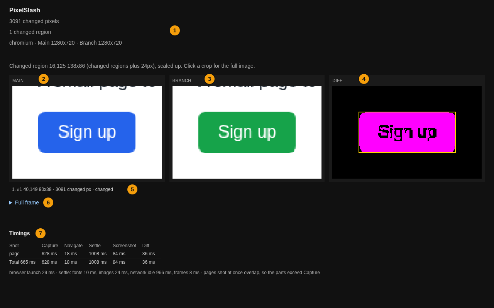
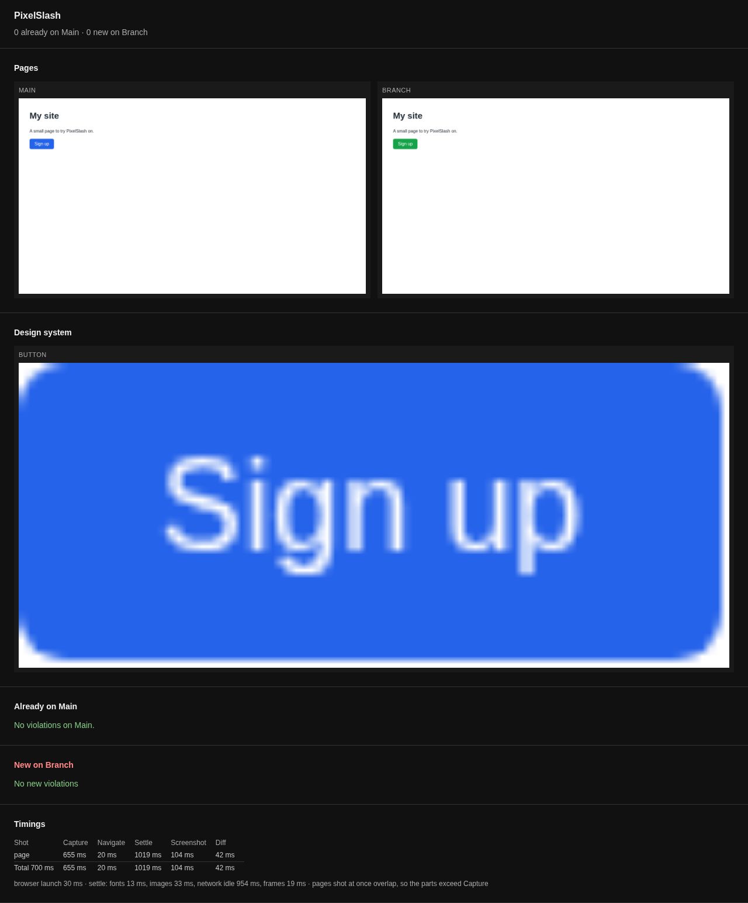
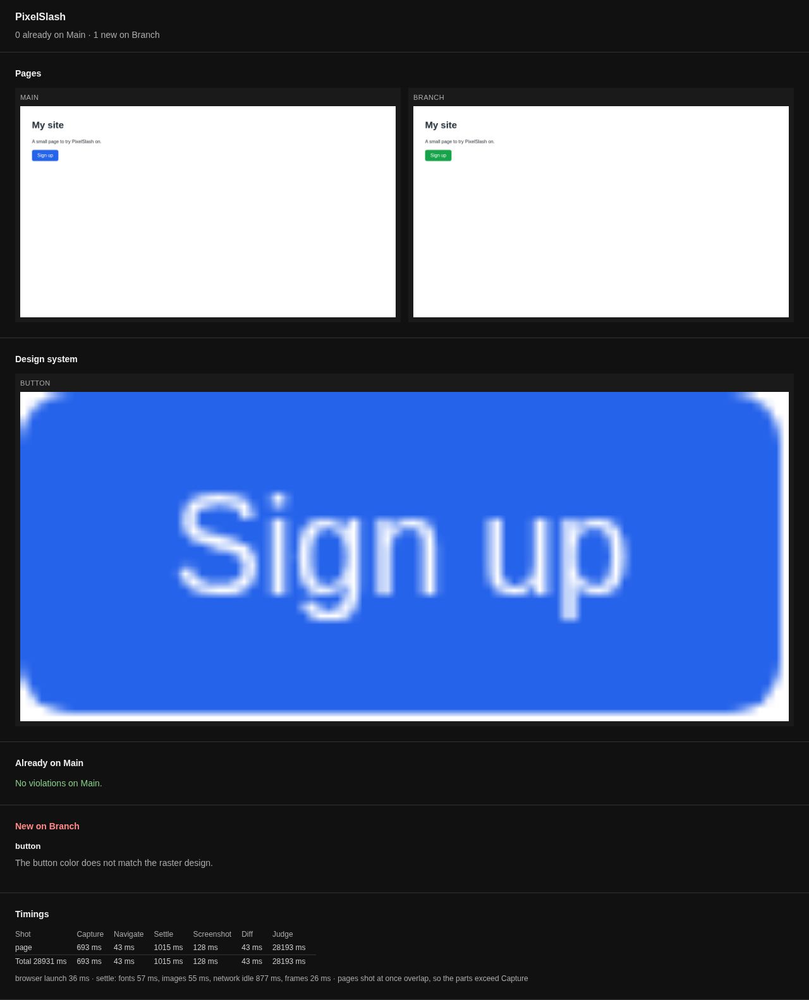

# Your first review

Make a change on purpose, let PixelSlash find it, read what it found, and decide. Then let a local vision model check the same page against your design system.

This carries on from [Getting started](../getting-started.md), with the two servers up on ports 4101 and 4102 and the two versions the same. Everything stays on your machine.

## Found

Turn the button green on Branch. This is GNU `sed`; on a Mac, use `sed -i ''`, or edit the file by hand:

```
sed -i 's/#2563eb/#16a34a/' branch/index.html
npx pixelslash --live http://localhost:4101 --local http://localhost:4102 --out .pixelslash
```

```
pixelslash: 3091 changed pixels
report: file:///…/my-site/.pixelslash/report.html
timing: 1 shot, capture 0.6s, diff 0.0s, total 0.7s
```

The line that matters is the first. You changed one colour, and that is a few thousand pixels. A count that large on a change you did not make is worth stopping for.

## Read

Open `.pixelslash/report.html`, and go through it from the top:



- **Is it one region, where you expected?** Here the header says "1 changed region" and the list says `#1 40,149 90x38 · 3091 changed px`: the button, and nothing else. A second region is a change you did not plan.
- **Do the crops show what you meant?** Main is blue, Branch is green.
- **Does it look right in place?** Open `Full frame` to see the whole page. A crop can look fine in a layout that has broken around it.

## Judged

The diff can tell you that a change happened. Only you can tell whether it was meant to. If you meant it, keep it. If you did not, fix Branch and run again: you want `pixelslash: 0 changed pixels`.

Nothing is recorded by this decision. Your review of a local run is reading a report. To record a yes or no and have CI wait on it, you need [a review server](../ci/review-server.md), on a server you run yourself.

## Against your design system: `--ds`

Pixels compare Branch with Main. The judge asks another question: does this page break your design system? `--ds` takes a directory of PNGs, one per component, each named for the component.

Make one by cutting the button out of `.pixelslash/main.png` with any image editor. It is the blue one, the way the design system has it:

```
design-system/
  button.png
```

Then run with `--ds`:

```
npx pixelslash --live http://localhost:4101 --local http://localhost:4102 --ds design-system --out .pixelslash-ds
```

### With no judge installed

The judge is a local vision model. With none on your `PATH`, this is what you get:

```
skip: no judge
report: file:///…/my-site/.pixelslash-ds/report.html
timing: 1 shot, capture 0.7s, diff 0.0s, total 0.7s
```

The exit code is 0, and the report is still written, with the shots and the design system. PixelSlash does not invent a violation it did not look for, and its "No new violations" here means none were recorded:



### With a judge

Install [Ollama](https://ollama.com), and pull the model. Nothing leaves your machine:

```
ollama pull qwen2.5vl
```

The same command now takes half a minute and exits 1:

```
pixelslash: 0 already on main, 1 new on branch (button)
report: file:///…/my-site/.pixelslash-ds/report.html
timing: 1 shot, capture 0.7s, diff 0.0s, judge 28.2s, total 28.9s
```

The report separates what Branch brought from what Main already had. A violation that is already on Main is not your change, and does not fail the run:



The model said "The button color does not match the raster design." A vision model's words differ from run to run, and it can be wrong. Treat it as a second reader, not a measurement. [The design-system judge](../cli.md#the-design-system-judge) has the other engines.

This is the one way a finished run exits 1: new violations on Branch. A pixel-only run exits 0. A capture that cannot finish, such as a server that is down, also exits 1, and prints what failed.

## Next

- The other ways to make the shots: [choose how to capture](choose-capture.md).
- Fail a CI job on a difference: [Run it in CI](../ci/github-actions.md).
