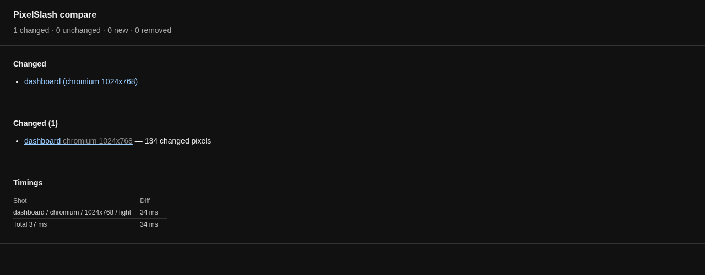
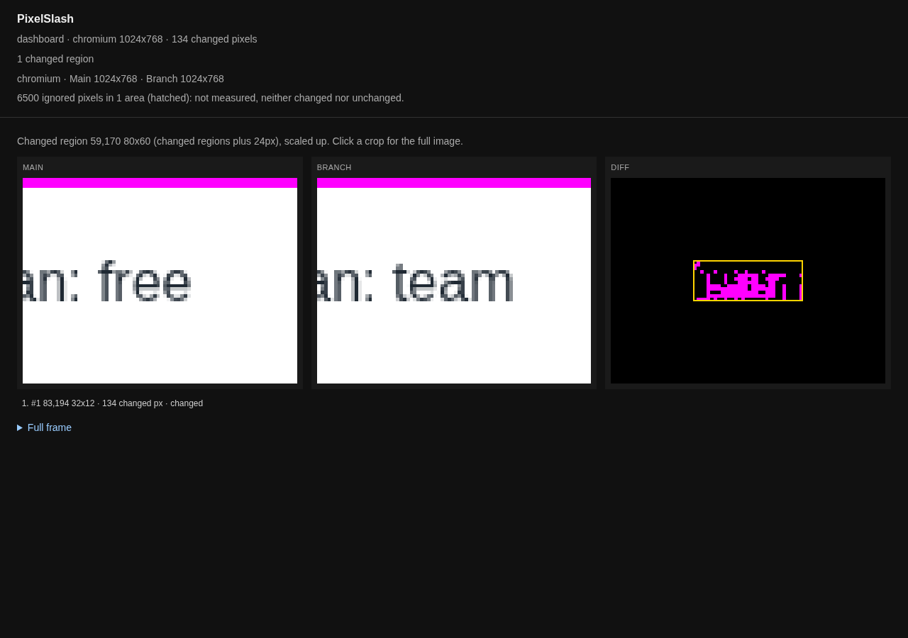

# Your Playwright tests

Your tests already log in, click through and reach the states you care about. Take the shots there, with one call, on plain Node.

The helper is `@hackcove/pixelslash-playwright` on npm. It runs in your tests with no Bun. Comparing the results later uses the CLI, which does need [Bun](https://bun.sh) on your `PATH`.

## Install

In a project with Playwright, or in a new one:

```
mkdir my-tests && cd my-tests
npm init -y
npm pkg set type=module
npm install -D @playwright/test @hackcove/pixelslash-playwright @hackcove/pixelslash
npx playwright install chromium-headless-shell
```

## A first spec

This spec opens the dashboard from [the sample site](urls.md#the-sample-site), so have Main on port 4101 and Branch on port 4102. Point it at your own app if you have one.

`playwright.config.ts`:

```ts
import { defineConfig } from "@playwright/test";

export default defineConfig({
  testDir: "./tests",
  reporter: "list",
  use: {
    baseURL: process.env.BASE_URL ?? "http://localhost:4101",
    browserName: "chromium",
    // snapshot() needs a launched chromium and a fixed viewport.
    viewport: { width: 1024, height: 768 },
  },
});
```

`tests/dashboard.spec.ts`:

```ts
import { test } from "@playwright/test";
import { snapshot } from "@hackcove/pixelslash-playwright";

test("the dashboard", async ({ page }) => {
  await page.goto("/dashboard");
  // The clock moves on every shot, so the diff skips it. The token is painted over before the PNG is written.
  await snapshot(page, "dashboard", { ignore: ["#clock"], redact: [".token"] });
});
```

`snapshot(page, name, options)` takes the shot. Both options take selectors:

- `ignore` leaves an area out of the diff. The pixels stay in the PNG.
- `redact` paints an area over before the PNG is written, so what was there never reaches the file. Use it for tokens and personal data.

## Run it on each side

`PIXELSLASH_SNAPSHOT_DIR` says where the shots go, and `BASE_URL` is read by the config above:

```
PIXELSLASH_SNAPSHOT_DIR=snapshots/main BASE_URL=http://localhost:4101 npx playwright test
PIXELSLASH_SNAPSHOT_DIR=snapshots/branch BASE_URL=http://localhost:4102 npx playwright test
```

```
  ✓  1 tests/dashboard.spec.ts:4:1 › the dashboard (1.1s)

  1 passed (1.5s)
```

Each directory now has `dashboard/1024x768-light.png` and a `manifest.json`, where the `#clock` selector has become the rectangle it covered:

```json
"ignore": [{ "x": 40, "y": 109, "width": 260, "height": 25 }]
```

## Compare the two directories

```
npx pixelslash compare snapshots/main snapshots/branch --out report
```

```
timing: 1 shot, diff 0.0s, total 0.0s
pixelslash: 1 changed, 0 unchanged, 0 new, 0 removed
changed:
  dashboard (chromium 1024x768)
report: file:///…/my-tests/report/index.html
```

The exit code is 0. Open `report/index.html`:



The report has the plan's change from free to team, and says what it did not measure: "6500 ignored pixels". The band across Main's crop is the redacted token:



## What a bare fingerprint means

Each manifest records what rendered its shots:

```json
{ "image": "bare", "browser": "chromium 156.0.8078.4", "fonts": "sha256:3d5233441c23835446e52afc8f746b743eb35219a7ff85478ef358fb999cb433" }
```

`bare` means the shots did not come from the pinned capture image: they came from your own browser, with your machine's fonts. It is not an error. Two machines can draw the same page differently, though, so keep both sides of a comparison on one machine, or one CI runner image. When the fingerprints of two sides differ, `compare` warns and diffs anyway, and then a font can look like a change.

## Next

- A complete project, with a test that runs on plain Node: [`examples/playwright-node`](../../examples/playwright-node/README.md).
- Everything `snapshot` takes: [Snapshots from your own Playwright tests](../cli.md#snapshots-from-your-own-playwright-tests).
- Run it on every pull request: [Run it in CI](../ci/github-actions.md).
