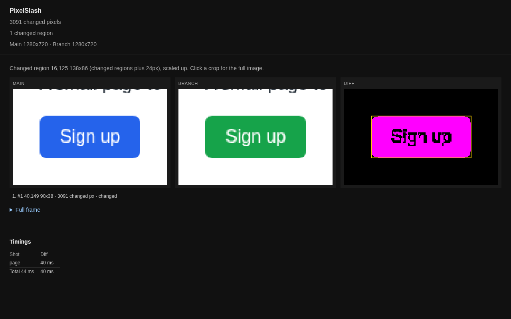
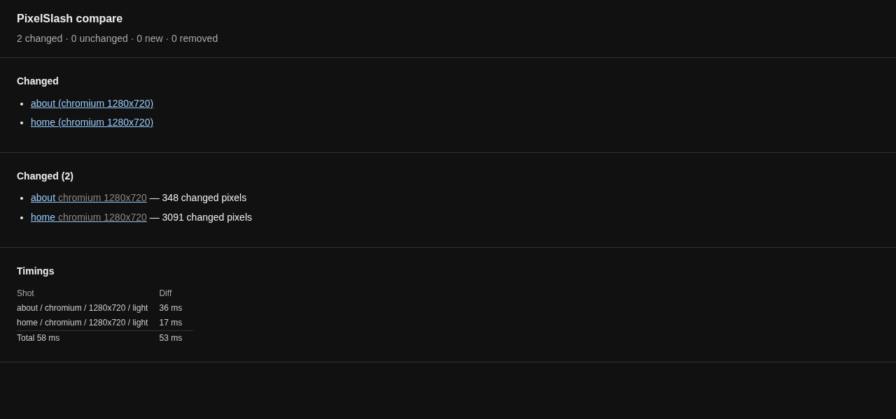
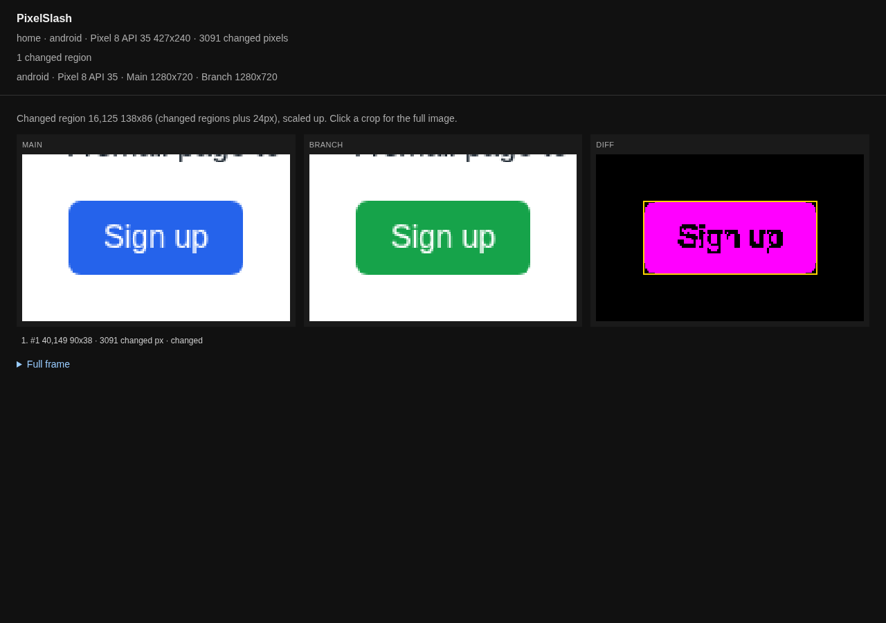

# PNGs you already have

If something else already makes your screenshots, PixelSlash can diff them with no browser. Nothing here needs `install-browser`.

You need the package from [Getting started](../getting-started.md): `npm i -D @hackcove/pixelslash`. Bun has to be on your `PATH`. The examples run in `~/my-pngs`.

## Two PNGs

```
npx pixelslash --live-png main.png --local-png branch.png --out .pixelslash --label "button colour"
```

```
pixelslash: 3091 changed pixels
report: file:///…/my-pngs/.pixelslash/report.html
timing: 1 shot, diff 0.0s, total 0.0s
```

The exit code is 0. `.pixelslash` holds `branch.png`, `diff.png`, `live.png`, `local.png`, `main.png`, `manifest.json` and `report.html`, and `--label` is kept in the manifest.



Two files with the same bytes are not decoded at all, and the count is `pixelslash: 0 changed pixels`.

## A directory of PNGs: `import`

`import` turns a directory of PNGs into a snapshot directory, which `compare` can read. A file's name is its shot's name, so `shots/main/home.png` pairs with `shots/branch/home.png`.

`--viewport` is the size the shots were taken at. `--renderer` names what made them, here a Cypress suite, and goes into the fingerprint:

```
npx pixelslash import shots/main --viewport 1280x720 --renderer "cypress 15" --out snaps/main
npx pixelslash import shots/branch --viewport 1280x720 --renderer "cypress 15" --out snaps/branch
```

```
pixelslash: 2 snapshots
manifest: …/my-pngs/snaps/main/manifest.json
```

The fingerprint in the manifest says where the shots came from, and `fonts` is `unknown` because PixelSlash did not see the browser:

```json
{ "image": "external", "browser": "cypress 15", "fonts": "unknown" }
```

Then compare the two directories:

```
npx pixelslash compare snaps/main snaps/branch --out report
```

```
timing: 2 shots, diff 0.1s, total 0.1s
pixelslash: 2 changed, 0 unchanged, 0 new, 0 removed
changed:
  about (chromium 1280x720)
  home (chromium 1280x720)
report: file:///…/my-pngs/report/index.html
```



## Native screenshots

For a mobile app, name the platform and device. `--device` and `--scale` are required, and the scale turns the PNG's pixels into a viewport:

```
npx pixelslash import shots/android/main --platform android --device "Pixel 8 API 35" --scale 3 --out snaps/android-main
npx pixelslash import shots/android/branch --platform android --device "Pixel 8 API 35" --scale 3 --out snaps/android-branch
npx pixelslash compare snaps/android-main snaps/android-branch --out report-android
```

```
note: home.png: 1280x720 px at scale 3 is viewport 427x240
pixelslash: 1 snapshots
```

```
timing: 1 shot, diff 0.0s, total 0.0s
pixelslash: 1 changed, 0 unchanged, 0 new, 0 removed
changed:
  home (android · Pixel 8 API 35 427x240)
report: file:///…/my-pngs/report-android/index.html
```



`--renderer` works here too, for the tool that took the shots:

```
npx pixelslash import shots/android/main --platform android --device "Pixel 8 API 35" --scale 3 --renderer "maestro 2.0" --out snaps/renderer
```

```json
{ "image": "external", "browser": "maestro 2.0", "fonts": "unknown", "platform": "android", "device": "Pixel 8 API 35", "scale": "3" }
```

These commands ran on stand-in PNGs that a browser made, not on a device. With Maestro, a flow's `takeScreenshot: name` and `maestro test --test-output-dir DIR` give you the directory to import. Maestro itself was not run for this page. [Native screenshots (Maestro)](../cli.md#native-screenshots-maestro) has the flow, and the checklist that keeps two runs of a device comparable.

## Next

- What the shots mean once they are in a report: [your first review](first-review.md).
- Everything `import` takes: [Snapshots from PNGs you already have](../cli.md#snapshots-from-pngs-you-already-have).
