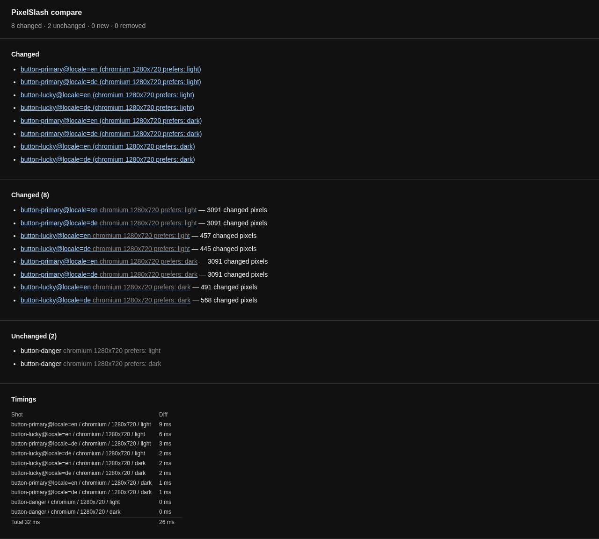
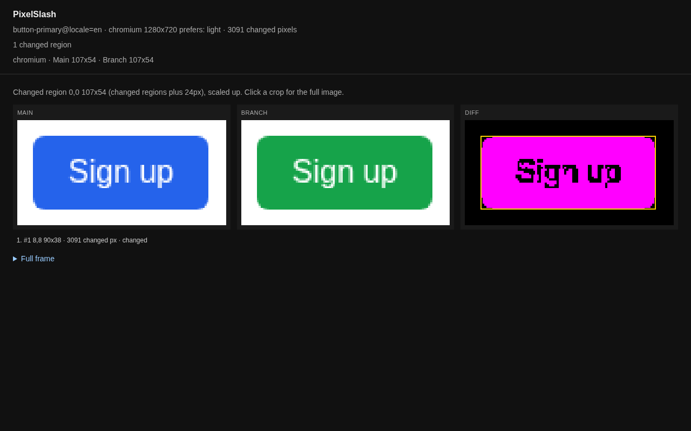

# A Storybook

Shoot every story in a Storybook, in light and dark, compare two runs, and control how each story is treated with a tag.

You need Bun on your `PATH`, and Storybook 7 or later. With an older one, capture stops with `needs Storybook 7 or later`.

## A Storybook to try it on

If you have a Storybook, start it, install PixelSlash, and skip this section:

```
npm i -D @hackcove/pixelslash
npx pixelslash install-browser
```

Otherwise, make a small one. `npm init -y` writes a CommonJS package and Storybook's config is an ES module, so set the type:

```
mkdir my-storybook && cd my-storybook
npm init -y
npm pkg set type=module
npm i -D storybook @storybook/html-vite vite @hackcove/pixelslash
npx pixelslash install-browser
mkdir .storybook src
```

`.storybook/main.js`:

```js
export default { stories: ["../src/**/*.stories.js"], framework: "@storybook/html-vite" };
```

`src/button.stories.js`. `Danger` and `Lucky` carry tags, which this page comes back to:

```js
const button = ({ label, background }) =>
  `<button style="background:${background};color:#fff;border:0;border-radius:6px;padding:10px 18px;font:16px sans-serif">${label}</button>`;

export default { title: "Button", render: button };

export const Primary = { args: { label: "Sign up", background: "#2563eb" } };

export const Danger = {
  args: { label: "Delete", background: "#dc2626" },
  tags: ["pixelslash-once"],
};

export const Lucky = {
  render: () => `<p>Lucky number: ${Math.random()}</p>`,
  tags: ["pixelslash-flaky-skip"],
};
```

Start it, and leave it running. Wait for `Storybook ready!` before going on: until then, capture stops with `storybook: cannot read http://localhost:6006/index.json`, and exit 1:

```
npx storybook dev -p 6006 --ci &
```

## Write the config

`init --storybook` takes the running Storybook's URL:

```
npx pixelslash init --storybook http://localhost:6006 --themes light,dark --viewports 1280x720 --yes
```

```
wrote pixelslash.config.ts
.gitignore: added pixelslash-snapshots/ .pixelslash/
```

It also prints the commands for uploading to a review server, which this page does not use: that is on a server you run yourself, see [self-hosting](../../apps/web/SELF-HOST.md). Here is what it wrote:

```ts
// Written by `pixelslash init`. Every option is in the PixelSlash CLI reference (docs/cli.md).
// No token goes in here: `pixelslash login`, or PIXELSLASH_TOKEN in CI.
export default {
  storybook: { url: "http://localhost:6006" },
  variants: [
    { viewport: { width: 1280, height: 720 }, theme: "light" },
    { viewport: { width: 1280, height: 720 }, theme: "dark" },
  ],
  // A shot that differs from itself: "review" (the default) puts it in front of a reviewer,
  // "skip" keeps it out of review. A route (or a story tag) can set its own.
  // flaky: "review",
  upload: {
    // server: "https://<your pixelslash server>"
    // project: "<project name>"
  },
};
```

Each story is shot at each variant. If your stories read a Storybook global, such as a locale, you can shoot each value of it too. This page does, so edit the `storybook` line:

```ts
storybook: { url: "http://localhost:6006", globals: { locale: ["en", "de"] } },
```

## Shoot the stories

```
npx pixelslash capture --out snapshots/main
```

```
warning: capturing outside the pinned PixelSlash image; local fonts skew rendering. Fingerprint recorded as bare.
pixelslash: 10 snapshots
fingerprint: {"image":"bare","browser":"chromium 156.0.8078.4","fonts":"sha256:3d5233441c23835446e52afc8f746b743eb35219a7ff85478ef358fb999cb433"}
manifest: …/my-storybook/snapshots/main/manifest.json
timing: 10 shots, capture 9.9s, total 4.0s
```

The warning is fair: this machine's fonts are in the shots, which is fine when both sides come from this machine. In CI, [capture in the pinned image](../ci/pin-versions.md). The sample stories do not declare `locale`, so Storybook's own log, in the same terminal, can say `Attempted to set a global (locale)`. The run is not affected.

Ten shots, because two stories are shot at two locales and two themes, and one is shot at two themes only. `init` ignored `pixelslash-snapshots/` and `.pixelslash/`, not the `snapshots/` and `report/` used here, so add those two to `.gitignore` if this is a git repository. The folder names say which is which:

```
button-danger/chromium-1280x720-light.png
button-primary@locale=en/chromium-1280x720-light.png
button-lucky@locale=de/chromium-1280x720-dark.png
```

## The two tags

A story's tags are in Storybook's index, so capture reads them before it opens a page.

- **`pixelslash-once`** shoots the story once, at the defaults of your globals. `Danger` is not shot per locale. It is still shot at each variant, so light and dark are both there.
- **`pixelslash-flaky-skip`** sets the story's flaky policy to skip, and `pixelslash-flaky-review` sets it to review. A flaky shot is one that differs from itself between captures. The policy is written to the manifest, where `Lucky` has `skip` and the others have `review`, and it acts when you upload to [a review server](../ci/review-server.md). `compare` on your own machine does not read it, as you will see below.

A misspelt flaky tag stops the run, with exit 2, rather than being ignored:

```
storybook: story "button--lucky" tag "pixelslash-flaky-skipp" must be pixelslash-flaky-review or pixelslash-flaky-skip
```

So do both flaky tags on one story:

```
storybook: story "button--lucky" has both pixelslash-flaky-review or pixelslash-flaky-skip
```

## Change one thing and compare

Turn the primary button green, capture again into another directory, and compare the two:

```
sed -i 's/#2563eb/#16a34a/' src/button.stories.js
npx pixelslash capture --out snapshots/branch
npx pixelslash compare snapshots/main snapshots/branch --out report
```

```
timing: 10 shots, diff 0.0s, total 0.0s
pixelslash: 8 changed, 2 unchanged, 0 new, 0 removed
changed:
  button-primary@locale=en (chromium 1280x720 prefers: light)
  button-primary@locale=de (chromium 1280x720 prefers: light)
  button-lucky@locale=en (chromium 1280x720 prefers: light)
  button-lucky@locale=de (chromium 1280x720 prefers: light)
  button-primary@locale=en (chromium 1280x720 prefers: dark)
  button-primary@locale=de (chromium 1280x720 prefers: dark)
  button-lucky@locale=en (chromium 1280x720 prefers: dark)
  button-lucky@locale=de (chromium 1280x720 prefers: dark)
report: file:///…/my-storybook/report/index.html
```

The exit code is 0. The four `button-primary` shots are your change. The four `button-lucky` shots are the random number, listed even though the story says skip: `compare` measures pixels and leaves the policy to a server. `button-danger` is the 2 unchanged.

## Read the report

Open `report/index.html`. It has a line per changed shot:



Follow one to its report, with Main, Branch and Diff:



[Getting started](../getting-started.md#open-the-report) goes through a report part by part.

## Next

- All of the Storybook keys, such as `include` and `exclude`: [Snapshot capture](../cli.md#snapshot-capture-the-pinned-image).
- Run it on every pull request: [Run it in CI](../ci/github-actions.md).
