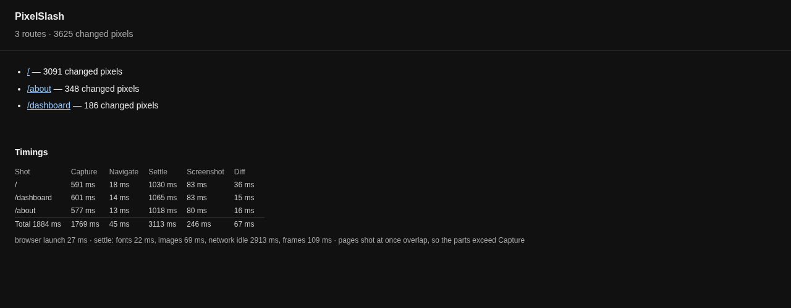
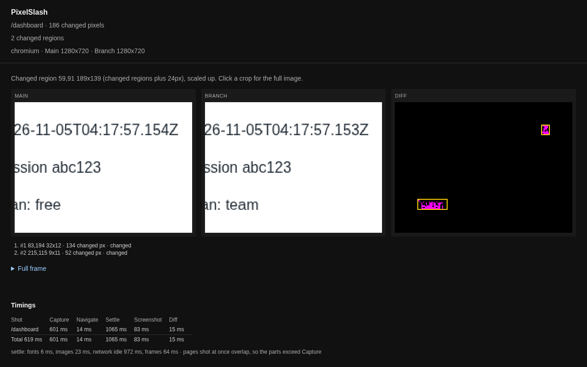
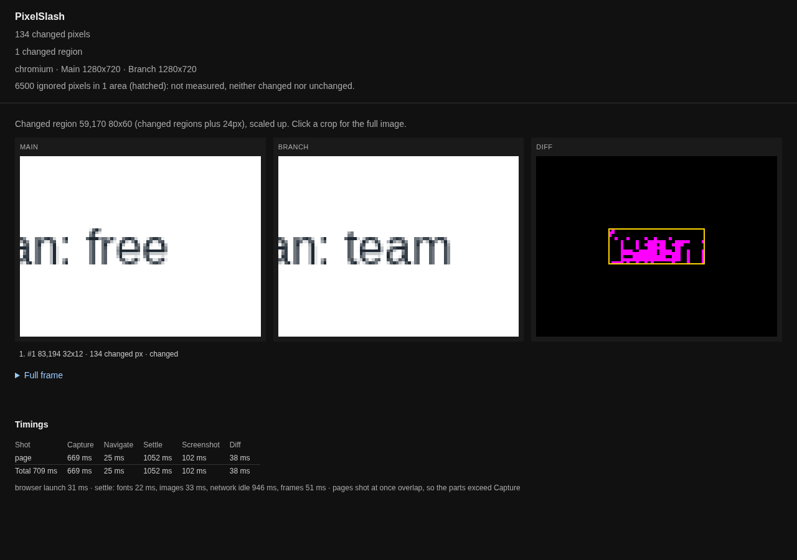
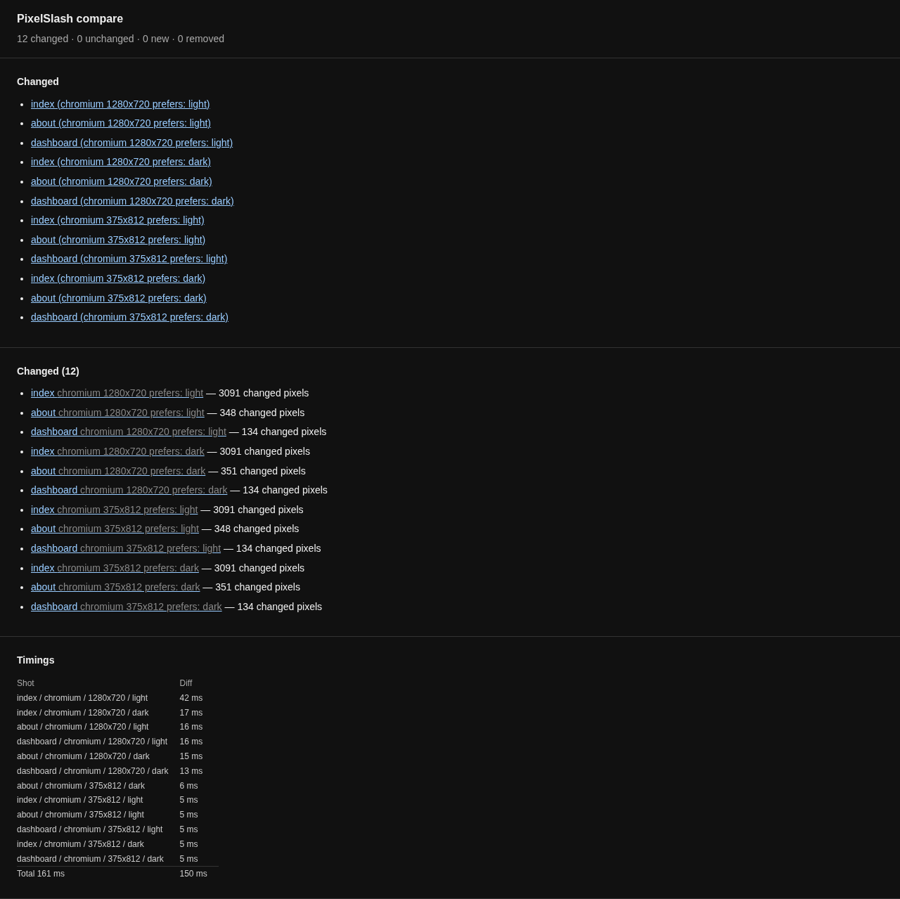

# A site by URL

Compare every page of a site from a list of paths, skip an area that moves on its own, then capture light and dark at two viewport sizes.

You need the install from [Getting started](../getting-started.md). As there, both versions must already be up, because PixelSlash does not start a dev server.

## The sample site

This page uses a small site with three pages, `main/` and `branch/`, in `~/my-site`. Use your own app if you have one, or add these beside the page from Getting started.

`main/about.html` has a dark mode, for later:

```
cat > main/about.html <<'HTML'
<!doctype html>
<html lang="en">
  <head>
    <meta charset="utf-8" />
    <title>About</title>
    <style>
      body { font: 16px/1.5 sans-serif; margin: 40px; color: #1f2933; }
      @media (prefers-color-scheme: dark) { body { background: #111827; color: #f3f4f6; } }
    </style>
  </head>
  <body>
    <h1>About</h1>
    <p>We make small pages.</p>
  </body>
</html>
HTML
```

`main/dashboard.html` has a clock that changes all the time, a session token and a plan:

```
cat > main/dashboard.html <<'HTML'
<!doctype html>
<html lang="en">
  <head>
    <meta charset="utf-8" />
    <title>Dashboard</title>
    <style>
      body { font: 16px/1.5 sans-serif; margin: 40px; color: #1f2933; }
      #clock { height: 24px; width: 260px; }
    </style>
  </head>
  <body>
    <h1>Dashboard</h1>
    <p id="clock"></p>
    <p class="token">session abc123</p>
    <p class="plan">Plan: free</p>
    <script>
      const tick = () => (document.getElementById("clock").textContent = new Date().toISOString());
      tick();
      setInterval(tick, 50);
    </script>
  </body>
</html>
HTML
```

Copy both to Branch, change a word in each, and turn the home page's button green if it is not already:

```
cp main/about.html main/dashboard.html branch/
sed -i 's/small pages/small, tidy pages/' branch/about.html
sed -i 's/Plan: free/Plan: team/' branch/dashboard.html
sed -i 's/#2563eb/#16a34a/' branch/index.html
```

## Every page, one report

`--routes` takes a file with one path per line, and `--live` and `--local` become origins:

```
printf '/\n/about\n/dashboard\n' > routes.txt
npx pixelslash --live http://localhost:4101 --local http://localhost:4102 --routes routes.txt --out .pixelslash
```

```
pixelslash: 3625 changed pixels
report: file:///…/my-site/.pixelslash/index.html
timing: 3 shots, capture 1.8s, diff 0.1s, total 1.9s
```

The exit code is 0, as for any pixel-only run. The report is now `.pixelslash/index.html`, with a line per route and each route's own report in a folder beside it:



Follow `/dashboard`. This run counts 186 pixels on it, and 134 of those are the plan. The rest is the clock, which ticks every 50 ms, so the count moves from run to run. Repeat runs of this command gave 3573 most often, and also 3612, 3615 and 3625. A 3573 is a run where both shots happened to show the same time.



## Skip an area: `--ignore`

`--ignore x,y,w,h` leaves a rectangle out of the diff. It applies to one pair, so name the page itself. With `--routes` it is a usage error (`--ignore applies to a single pair, not --routes`, exit 2):

```
npx pixelslash --live http://localhost:4101/dashboard --local http://localhost:4102/dashboard --ignore 40,109,260,25 --out .pixelslash-ignore
```

```
pixelslash: 134 changed pixels
report: file:///…/my-site/.pixelslash-ignore/report.html
timing: 1 shot, capture 0.7s, diff 0.0s, total 0.7s
```

The clock is gone from the count, and the real change, the plan, is still there. The count holds still too: five runs gave 134 each time. The report does not pretend the area was compared: it says "6500 ignored pixels in 1 area (hatched): not measured, neither changed nor unchanged."



## Light, dark and two viewports

For more than a pair of URLs, write a config:

```
npx pixelslash init --url http://localhost:4101 --routes /,/about,/dashboard --viewports 1280x720,375x812 --themes light,dark --yes
```

```
wrote pixelslash.config.ts
.gitignore: added pixelslash-snapshots/ .pixelslash/
```

It also prints what to run next, and those lines need a review server, on a server you run yourself ([self-hosting](../../apps/web/SELF-HOST.md)). This tutorial stays on your machine. The config lists the routes and one variant per viewport and theme:

```ts
export default {
  baseUrl: "http://localhost:4101",
  routes: ["/", "/about", "/dashboard"],
  variants: [
    { viewport: { width: 1280, height: 720 }, theme: "light" },
    { viewport: { width: 1280, height: 720 }, theme: "dark" },
    { viewport: { width: 375, height: 812 }, theme: "light" },
    { viewport: { width: 375, height: 812 }, theme: "dark" },
  ],
  // ...
};
```

A config has one `baseUrl`, and you are going to capture two servers, so read it from the environment:

```ts
baseUrl: process.env.BASE_URL ?? "http://localhost:4101",
```

Capture Main, then Branch:

```
npx pixelslash capture --out snapshots/main
BASE_URL=http://localhost:4102 npx pixelslash capture --out snapshots/branch
```

```
warning: capturing outside the pinned PixelSlash image; local fonts skew rendering. Fingerprint recorded as bare.
pixelslash: 12 snapshots
fingerprint: {"image":"bare","browser":"chromium 156.0.8078.4","fonts":"sha256:3d5233441c23835446e52afc8f746b743eb35219a7ff85478ef358fb999cb433"}
manifest: …/my-site/snapshots/main/manifest.json
timing: 12 shots, capture 7.4s, total 2.4s
```

The warning is fair: both sides came from this machine's fonts, which is fine for comparing them here. In CI, [capture in the pinned image](../ci/pin-versions.md). Three routes at four variants makes 12 shots, named like `about/chromium-1280x720-dark.png`. `init` ignored `pixelslash-snapshots/` and `.pixelslash/`, not the `snapshots/` and `report/` used here, so add those two to `.gitignore` if this is a git repository.

Compare the two directories:

```
npx pixelslash compare snapshots/main snapshots/branch --out report
```

```
timing: 12 shots, diff 0.1s, total 0.2s
pixelslash: 12 changed, 0 unchanged, 0 new, 0 removed
changed:
  index (chromium 1280x720 prefers: light)
  ...
  +2 more
report: file:///…/my-site/report/index.html
```



The dashboard's count is 134 at 1280x720 with no `--ignore`: `capture` freezes `Date` before it shoots, so the clock stands still. Two captures of the same server in a row compare as `0 changed, 12 unchanged`. A plain pair of URLs does not freeze it, which is why the first run above moved.

## Next

- Tune what counts as a change: [Tuning the diff](../cli.md#tuning-the-diff).
- Every key of the config: [Snapshot capture](../cli.md#snapshot-capture-the-pinned-image).
- Run it on every pull request: [Run it in CI](../ci/github-actions.md).
